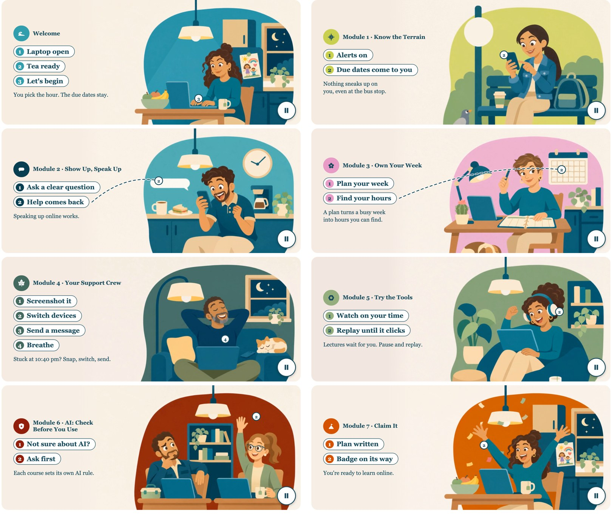

# Learning Online 101 · animation player

Short character animations for **Learning Online 101**, the online-readiness course at CSU Channel Islands
(Teaching and Learning Innovations). Each module opens with a "moment": a student meeting the challenge the module teaches.

- **Player:** https://ampenaranda.github.io/lo101-animations/index.html?m=M4&layout=wide
- **Portfolio:** https://ampenaranda.github.io/lo101-animations/portfolio/

## What the player does
- Plays a sharp 1280×720 video (shown at most 760 px wide, so 2× for Retina), loops with a short hold on the last frame.
- Shows the module emblem and name, then **numbered steps that appear in time with the action**, a **numbered marker** on the scene for each step,
  a dashed line only where the target is not obvious, and a one-line summary. Every word is live text set in code, never baked into the video.
- Two layouts: `layout=wide` (2.4:1, words on the left) and `layout=phone` (video on top, words below).
- Accessibility: a Play/Pause button that is always visible and keyboard operable (WCAG 2.2.2) · starts paused with all words shown when the
  device asks for reduced motion · every embed carries a title, and the page hosting it shows a written "What happens in this animation".

URL parameters: `m` = `W`, `M1` … `M7` · `layout` = `wide` (default) or `phone`.

## How it was made
1. **Characters:** eight scenes drawn in one flat style (no outlines, the same eyes, module colours) with OpenAI Image 2.6, with a start and an end pose for each.
2. **Motion:** Seedance 2.5 animated each pair of poses into a 6–8 second clip.
3. **Encoding:** ffmpeg, H.264, CRF 17, no audio, a poster frame per clip (`vid/`, `img/`).
4. **Player:** `tools/build_player.py` fills `tools/player_template.html` with the step words, marker positions (% of the frame),
   which steps get a line, and the summaries, and writes `index.html`.
5. **Course:** Canvas embeds the page in an iframe (a wide frame on a computer, the phone frame on a small screen).

## Editing
- Change words, markers or summaries in `tools/build_player.py` (`M = {...}`), then run `python3 tools/build_player.py` (paths in the script point at the
  course build folder; adjust if you run it here).
- Check text fit at six widths: `node tools/fit_check.mjs` must print `ALL FIT`. Capture frames with `node tools/capture_frames.mjs <out>` and make sure
  no marker sits on a face.
- Push to `main`; GitHub Pages updates in about a minute.

## Why GitHub Pages
Canvas does not play a video file stored in a course and does not run scripts in uploaded HTML, and the campus web host blocks being shown inside
another site. GitHub Pages allows embedding, so the player lives here and Canvas shows it in an iframe.

## Credits
Learning design and art direction: Ana Peñaranda, Teaching and Learning Innovations, CSU Channel Islands.
The characters are fictional and made with AI image tools (OpenAI Image 2.6), animated with Seedance 2.5. Words, layout and code are written by hand.
The campus map on the portfolio page is drawn from a public-domain USDA NAIP aerial image (2022).
